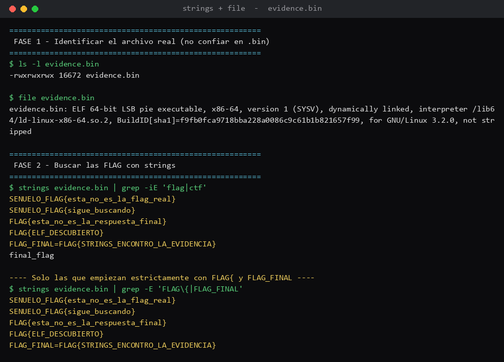

# Desafío 1 — La evidencia perdida (`file` y `strings`)

## Qué pedía el desafío

Me pasaron un archivo llamado `evidence.bin` y una nota que decía: *"La extensión puede mentir.
Antes de buscar información, descubre qué tienes realmente delante."* Había que resolverlo en dos
fases y sacar **dos FLAG**, pero solo con análisis estático, o sea mirando el archivo sin ejecutarlo.
Esa era la regla importante: no correrlo.

## Con qué lo hice

- **`file`**: mira los primeros bytes de un archivo y te dice qué es de verdad, sin importar la
  extensión. Lo usé para la Fase 1, para saber qué tenía en las manos.
- **`strings`**: saca todo el texto legible que haya dentro de un archivo binario. Lo usé en la
  Fase 2 para buscar las FLAG escritas adentro.

Las dos vienen en Linux, así que las corrí en mi WSL sin instalar nada.

## Lo que fui haciendo

Primero quise ver qué era el archivo. Como la nota avisaba que la extensión miente, en vez de
confiar en el `.bin` le pasé `file`:

```
$ file evidence.bin
evidence.bin: ELF 64-bit LSB pie executable, x86-64, ... not stripped
```

Ahí saltó la primera: no es un `.bin` cualquiera, es un **ELF**, que es el formato de los
ejecutables de Linux (el equivalente a un `.exe` de Windows). Esa es la pista de la Fase 1: el
archivo es un programa de Linux. Y de paso, saber que es texto/ejecutable me decía que adentro
iba a haber cadenas legibles para buscar con `strings`.

Después pasé a la Fase 2, a buscar las FLAG adentro con `strings` y un `grep` para filtrar solo
lo que me interesaba:

```
$ strings evidence.bin | grep -iE 'flag|ctf'
SENUELO_FLAG{esta_no_es_la_flag_real}
SENUELO_FLAG{sigue_buscando}
FLAG{esta_no_es_la_respuesta_final}
FLAG{ELF_DESCUBIERTO}
FLAG_FINAL=FLAG{STRINGS_ENCONTRO_LA_EVIDENCIA}
```

## Donde me enredé

Acá me compliqué un rato, porque aparecían como cinco cosas que parecían FLAG y no todas lo eran.
Dos partían con `SENUELO_` (señuelo, o sea trampa), así que esas fuera al tiro. Pero quedaba una,
`FLAG{esta_no_es_la_respuesta_final}`, que tenía el formato bueno y por un segundo pensé que era
esa. Leyéndola bien, el mismo texto decía "esta no es la respuesta final", así que también era
carnada. Las que quedaban con sentido eran `FLAG{ELF_DESCUBIERTO}` (que calza con la Fase 1, haber
descubierto que era un ELF) y la que venía marcada como `FLAG_FINAL=`, que es la de la Fase 2.

## Las pistas

Usé las dos que venían en el enunciado: "no confíes en la extensión" (por eso partí con `file`)
y "las herramientas principales son `file` y `strings`". No pedí pistas extra.

## Las FLAG

- **FLAG 1 (Fase 1):** `FLAG{ELF_DESCUBIERTO}`
- **FLAG 2 (Fase 2):** `FLAG{STRINGS_ENCONTRO_LA_EVIDENCIA}`

Señuelos descartados: `SENUELO_FLAG{esta_no_es_la_flag_real}`, `SENUELO_FLAG{sigue_buscando}` y
`FLAG{esta_no_es_la_respuesta_final}`.

## Qué saqué en limpio

Que la extensión de un archivo es solo una etiqueta y se puede cambiar; lo que manda es el
contenido, y `file` lo destapa en un segundo. Y que `strings` es súper útil para pescar texto
escondido, pero hay que leer lo que uno encuentra, porque los que arman estos desafíos ponen
trampas a propósito para que uno no corte y pegue la primera FLAG que ve. Eso sería.


