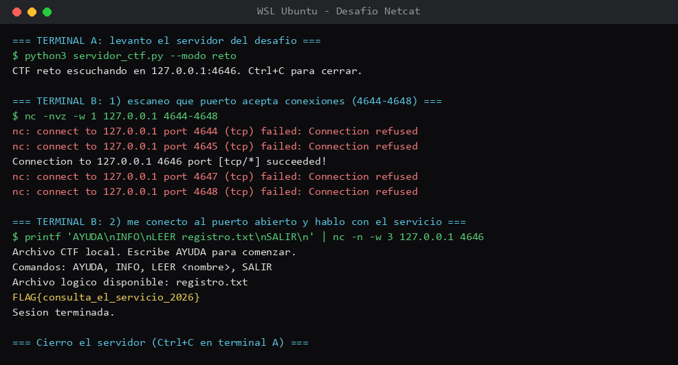

# Desafío 2 — El registro perdido (Netcat)

## Qué pedía el desafío

Me dieron un archivo `servidor_ctf.py` que levanta un pequeño servidor en mi propio equipo, y con
Netcat tenía que conectarme a él y conseguir la FLAG. La gracia es que no se podía mirar el código
del servidor para "hacer trampa": había que hablarle de verdad desde afuera. El alcance era la
dirección `127.0.0.1` (mi propia máquina), por TCP, y la FLAG estaba en alguno de los puertos del
`4644` al `4648`.

## Con qué lo hice

- **Netcat (`nc`)**: es como un cable para conectarse a mano a cualquier puerto y escribir/leer
  texto. Sirve tanto para ver qué puertos están abiertos como para conversar con un servicio.
- **Python 3**: solo para dejar corriendo el servidor del desafío.

Todo en la misma WSL, con dos terminales: una para el servidor y otra para atacar.

## Lo que fui haciendo

En la primera terminal dejé andando el servidor:

```
$ python3 servidor_ctf.py --modo reto
CTF reto escuchando en 127.0.0.1:4646. Ctrl+C para cerrar.
```

En la segunda, aunque el servidor ya decía el puerto, igual lo comprobé con Netcat como pedía el
enunciado, escaneando el rango permitido:

```
$ nc -nvz -w 1 127.0.0.1 4644-4648
nc: connect to 127.0.0.1 port 4644 (tcp) failed: Connection refused
nc: connect to 127.0.0.1 port 4645 (tcp) failed: Connection refused
Connection to 127.0.0.1 4646 port [tcp/*] succeeded!
nc: connect to 127.0.0.1 port 4647 (tcp) failed: Connection refused
nc: connect to 127.0.0.1 port 4648 (tcp) failed: Connection refused
```

El único que aceptaba conexión era el **4646**. Ahí me conecté y le mandé los comandos que el
mismo servicio iba pidiendo (primero `AYUDA` para saber qué se podía hacer, después `INFO`, y como
me nombró un archivo lógico, lo leí con `LEER`):

```
$ printf 'AYUDA\nINFO\nLEER registro.txt\nSALIR\n' | nc -n -w 3 127.0.0.1 4646
Archivo CTF local. Escribe AYUDA para comenzar.
Comandos: AYUDA, INFO, LEER <nombre>, SALIR
Archivo logico disponible: registro.txt
FLAG{consulta_el_servicio_2026}
Sesion terminada.
```

## Donde me enredé

Dos cosas chicas. La primera: `nc` tiene varias versiones y al principio los flags no me calzaban;
me resultó con `netcat-openbsd` usando `-nvz` para escanear (el `-z` es solo "toca y cierra" sin
mandar nada, y el `-v` para que me cuente qué pasó con cada puerto). La segunda: cuando me conecté
a mano, si me quedaba pensando mucho el servidor me botaba por inactividad a los ~15 segundos. Por
eso al final le mandé todos los comandos juntos con `printf ... | nc`, así no alcanzaba a cortarme
y quedaba toda la conversación en una sola corrida.

## Las pistas

No necesité pistas extra. El propio servicio te va guiando: `AYUDA` lista los comandos y te dice
que hay un `registro.txt` disponible, así que la secuencia salía sola leyendo lo que respondía.

## La FLAG

`FLAG{consulta_el_servicio_2026}` — en el puerto **4646**.

## Qué saqué en limpio

Que Netcat es simple pero potente: con un comando sé qué puerto está escuchando, y con otro me pongo
a conversar con el servicio como si fuera un chat. También entendí que muchos servicios te entregan
la información si uno simplemente les pregunta bien (el típico "pídelo con `AYUDA`"), sin necesidad
de romper nada. Eso sería.


