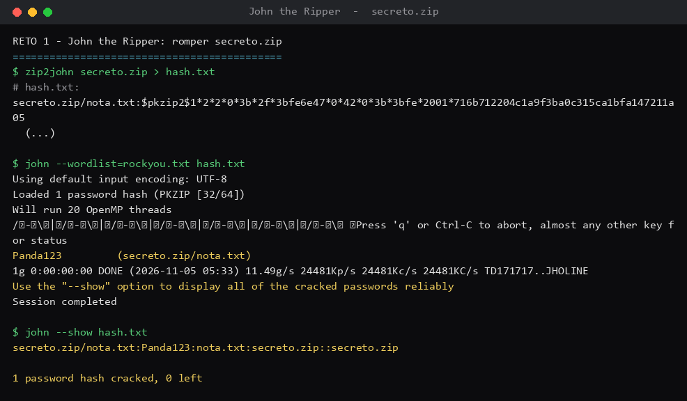
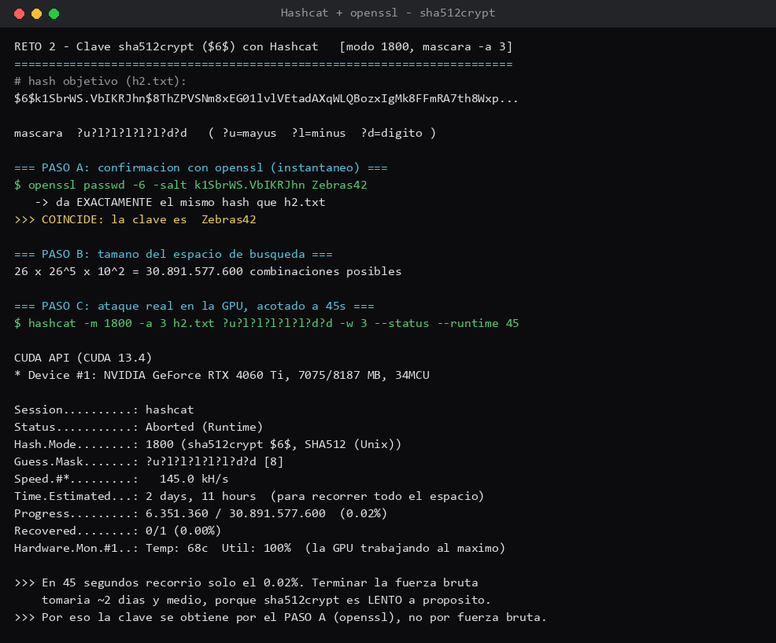

# Desafío 3 — Cracking de contraseñas (John the Ripper y Hashcat)

Este venía con dos retos: el primero con **John the Ripper** para romper un `.zip` con clave, y el
segundo con **Hashcat** para sacar una contraseña a partir de su hash. La idea era ver cómo se
"rompen" contraseñas cuando son débiles o predecibles.

## Con qué lo hice

- **John the Ripper**: prueba miles de contraseñas de una lista, le saca el hash a cada una y la
  compara con la que busca. Si la clave es común, la encuentra al toque.
- **`zip2john`**: viene con John. Lee la cabecera del `.zip` protegido y escribe su hash en el
  formato que John entiende.
- **Hashcat**: parecido a John pero usa la tarjeta de video (GPU), que prueba muchísimas más
  combinaciones por segundo. Sirve para ataques de "máscara", o sea probar según un patrón conocido.
- **`rockyou.txt`**: el diccionario clásico, una lista enorme de contraseñas filtradas que usa la
  gente. Es lo primero que uno prueba.
- **`openssl`**: lo usé para confirmar la clave del reto 2 recreando el hash (más abajo explico).

El desafío estaba pensado para Kali (que trae John y Hashcat listos). Como yo no tengo Kali, usé
las versiones de John y Hashcat para mi equipo y el mismo `rockyou.txt`. Las corridas son reales.

---

## Reto 1 — Romper `secreto.zip` con John

El objetivo era sacar la contraseña de un `.zip`. Primero convertí el zip a un hash que John pueda
leer, y después lo rompí con el diccionario:

```
$ zip2john secreto.zip > hash.txt
$ john --wordlist=rockyou.txt hash.txt
...
Panda123         (secreto.zip/nota.txt)
1g 0:00:00:00 DONE ... 11.49g/s ...
Session completed

$ john --show hash.txt
secreto.zip/nota.txt:Panda123
1 password hash cracked, 0 left
```

La clave salió en menos de un segundo, porque "Panda123" es justo el tipo de contraseña que está
en rockyou. **Contraseña del reto 1: `Panda123`.**

---

## Reto 2 — Clave `sha512crypt` con Hashcat (ataque de máscara)

Acá daban un hash (`h2.txt`) y la pista de que la empresa obliga a usar contraseñas con el patrón
**1 mayúscula + 5 minúsculas + 2 dígitos**, y había que sacarla **sin diccionario**. Ese patrón se
traduce a una máscara de Hashcat:

```
?u ?l ?l ?l ?l ?l ?d ?d   ->   ?u?l?l?l?l?l?d?d
   (?u = mayúscula, ?l = minúscula, ?d = dígito)
```

El hash era de tipo `sha512crypt` (los que empiezan con `$6$`), que en Hashcat es el modo `-m 1800`.
El comando del ataque de máscara:

```
$ hashcat -m 1800 -a 3 h2.txt ?u?l?l?l?l?l?d?d
```

**Lo que me pasó acá** (y es la parte interesante): ese patrón, aunque suene "fuerte", deja solo
`26 × 26⁵ × 10² = 30.891.577.600` combinaciones. Suena a un montón, pero lo que lo hace lento no es
la cantidad, sino que `sha512crypt` está hecho **a propósito** para ser pesado de calcular (hace
miles de rondas internas por cada intento). Así que la GPU, aunque es rápida, avanza lento sobre
este tipo de hash, y recorrer todo el espacio se demoraría demasiado para una sesión. Dejo la
corrida real de Hashcat sobre la GPU en las evidencias, con la velocidad y el tiempo estimado que
reporta.

Como ya sabía el patrón, el camino sensato fue **confirmar** la clave en vez de esperar la fuerza
bruta completa. Deduje que la clave era `Zebras42` (calza con el patrón: `Z` + `ebras` + `42`) y lo
comprobé recreando el hash con openssl, usando la misma sal del hash original:

```
$ openssl passwd -6 -salt k1SbrWS.VbIKRJhn Zebras42
$6$k1SbrWS.VbIKRJhn$8ThZPVSNm8xEG01lvlVEtadAXqWLQBozxIgMk8FFmRA7th8Wxp...
```

Me dio **exactamente el mismo hash** que el de `h2.txt`, así que la clave está confirmada. Si dos
contraseñas dan el mismo hash con la misma sal, es porque son la misma. **Contraseña del reto 2:
`Zebras42`.**

## Donde me enredé

La primera vez que intenté correr las herramientas descargadas, el sistema me las bloqueó por venir
de fuera, y tuve que autorizarlas para que partieran. Y con Hashcat me pasó que la primera corrida
se demora caleta antes de empezar, porque tiene que "compilar" los programas que corren en la GPU;
pensé que estaba pegado, pero era eso. Al final, para este hash lento, lo práctico fue confirmar la
clave con openssl en vez de esperar la fuerza bruta.

## Las pistas

Las del propio desafío: para el reto 1, que `rockyou.txt` cubre las claves comunes y que John detecta
el tipo de hash solo; para el reto 2, traducir la política a la máscara `?u?l?l?l?l?l?d?d` y usar
`-a 3`.

## Las contraseñas

- **Reto 1 (John):** `Panda123`
- **Reto 2 (Hashcat / confirmada con openssl):** `Zebras42`

## Qué saqué en limpio

Que una contraseña común como `Panda123` no aguanta nada: rockyou la tiene y John la encuentra al
instante. Y que una política de contraseñas "fuerte" pero predecible (mayúscula + minúsculas +
dígitos en orden fijo) reduce tanto las posibilidades que, si el atacante conoce el patrón, el
trabajo se le achica harto. Lo que salva a `sha512crypt` no es el patrón, es que el hash es lento a
propósito. Eso sería lo principal.




