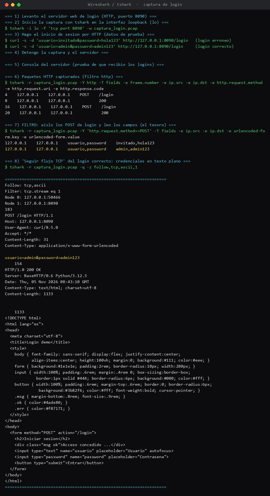

# Desafío 4 — Captura de un login HTTP (Wireshark / tshark)

## Qué pedía el desafío

La misión era capturar un inicio de sesión **no seguro (HTTP)** con Wireshark y analizar los datos
que viajan por la red. En concreto: iniciar la captura, hacer un login con datos de prueba en un
HTTP, detener la captura y después responder tres cosas — la IP de origen y la de destino, aislar
el login con un filtro, y el "tesoro": encontrar y revelar las credenciales que viajaron.

El desafío venía con un `Codigo_levantar_http_local.py`, que es un servidor de login chiquito para
levantar en el propio equipo y practicar la captura sin meterse con tráfico ajeno.

## Con qué lo hice

- **Wireshark / `tshark`**: Wireshark es el programa que "escucha" la red y guarda cada paquete
  que pasa. `tshark` es la misma cosa pero por consola, que es como lo corrí yo. Sirve para ver en
  crudo lo que viaja entre el navegador y el servidor.
- **La interfaz loopback (`lo`)**: como el servidor y el "cliente" estaban en la misma máquina, el
  tráfico no sale por la tarjeta de red normal sino por `lo`, que es la red interna del equipo
  (127.0.0.1 hablándole a 127.0.0.1). Por eso capturé en `lo`.
- **`curl`**: para hacer los logins de prueba y que quedaran grabados en la captura.

## Lo que fui haciendo

Dejé el servidor de login andando (puerto 8090) y partí la captura en `lo` filtrando solo ese
puerto, para no grabar basura de más:

```
$ tshark -i lo -f 'tcp port 8090' -w captura_login.pcap
```

Con la captura corriendo, hice dos logins con `curl`: uno malo a propósito y uno bueno, para tener
con qué comparar:

```
$ curl -s -d 'usuario=invitado&password=hola123' http://127.0.0.1:8090/login   (erroneo)
$ curl -s -d 'usuario=admin&password=admin123'   http://127.0.0.1:8090/login   (correcto)
```

Después detuve la captura y me puse a leer el `.pcap`. Primero filtré solo el HTTP para ubicar los
POST del login (ahí se ven las IP de origen y destino, las dos `127.0.0.1` porque es local):

```
$ tshark -r captura_login.pcap -Y http -T fields -e frame.number -e ip.src -e ip.dst -e http.request.method -e http.request.uri -e http.response.code
4   127.0.0.1  127.0.0.1  POST  /login
8   127.0.0.1  127.0.0.1                200
16  127.0.0.1  127.0.0.1  POST  /login
20  127.0.0.1  127.0.0.1                200
```

Y el tesoro: aislando los POST se leen los campos tal cual se enviaron, en texto plano:

```
$ tshark -r captura_login.pcap -Y 'http.request.method==POST' -T fields -e urlencoded-form.key -e urlencoded-form.value
usuario,password   invitado,hola123
usuario,password   admin,admin123
```

Para rematar, usé "Seguir flujo TCP" (el `follow,tcp` de tshark), que es lo mismo que en Wireshark
botón derecho → Follow TCP Stream, y ahí se ve la petición completa con la clave a la vista:

```
POST /login HTTP/1.1
Host: 127.0.0.1:8090
...
usuario=admin&password=admin123
```

## Donde me enredé

Al principio capturé en la interfaz equivocada. Como el login era en `127.0.0.1`, no aparecía nada
en la tarjeta de red normal (`eth0`), porque ese tráfico nunca sale del equipo; había que escuchar
en `lo`, la interfaz interna. Apenas cambié a `lo` empezaron a salir los paquetes. Lo otro fue que
la consola del servidor me quedaba vacía por el buffer de Python, pero eso era solo cosmético: lo
importante, los paquetes, estaba igual en el `.pcap`.

## Las pistas

Las del propio enunciado: identificar IP origen/destino, usar un filtro para aislar el login, y
buscar el "tesoro" que son las credenciales. Con el filtro `http.request.method==POST` quedó aislado
el login al tiro.

## El tesoro (credenciales)

Este desafío no entrega una `FLAG{...}`, lo que pide es **revelar las credenciales** que viajan sin
cifrar. Y ahí estaban:

- **Usuario:** `admin`
- **Contraseña:** `admin123`
- IP origen y destino: `127.0.0.1` → `127.0.0.1` (es todo local), puerto destino 8090.

## Qué saqué en limpio

Que en HTTP sin cifrar la contraseña viaja en texto plano, literal, y con una herramienta como
Wireshark se lee sin ningún esfuerzo. Verlo uno mismo convence mucho más que que te lo cuenten.
También entendí para qué sirven los filtros: sin ellos la captura es un mar de paquetes, y con un
filtro corto uno se queda justo con el login que buscaba. Eso sería.


