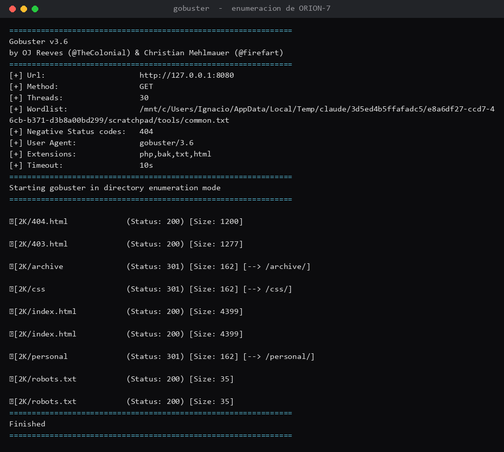
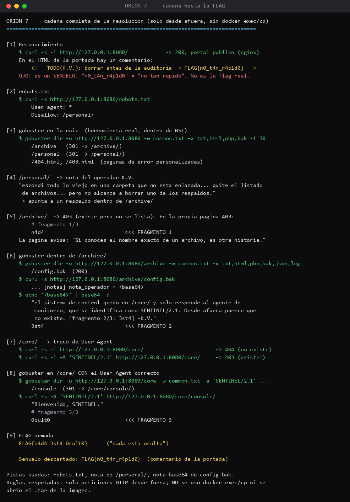

# Desafío 5 — ORION-7 (gobuster)

## Qué pedía el desafío

ORION-7 es una instalación de datos inventada. El operador K. Vidal se fue y dejó cosas escondidas
en el servidor, fuera de la vista del público. La misión era encontrarlas y armar la FLAG, que
estaba **partida en 3 pedazos** repartidos por el sitio:

```
FLAG{fragmento1_fragmento2_fragmento3}
```

Con un aviso importante: *no todo lo que parece FLAG lo es*. Y reglas claras: el único objetivo es
`http://localhost:8080` levantado en mi propio equipo, se resuelve **desde fuera** (como un
atacante), **sin** mirar la imagen ni el contenedor de Docker por dentro (nada de `docker exec`,
`docker cp` ni abrir el `.tar`). La herramienta principal era **gobuster**, con el diccionario
`common.txt` de SecLists.

## Con qué lo hice

- **Docker**: el desafío viene como una imagen que se levanta como contenedor y queda sirviendo el
  sitio en `localhost:8080`. Lo levanté con Docker adentro de la WSL.
- **gobuster**: prueba un montón de nombres de un diccionario contra el sitio para descubrir
  páginas y carpetas que existen pero no están enlazadas en ningún lado. Es la herramienta estrella
  acá.
- **`curl`** y **`base64`**: `curl` para pedir cada página a mano, y `base64 -d` para decodificar
  un texto que estaba escondido codificado.

## Lo que fui haciendo

Partí mirando la portada. En el HTML había un comentario con `FLAG{n0_t4n_r4p1d0}`. Me dieron ganas
de cantar victoria, pero justo el desafío avisa que no todo lo que parece FLAG lo es, y "n0 t4n
r4p1d0" es literal "no tan rápido": era un señuelo para los apurados.

Después el `robots.txt`, que es el archivo donde un sitio dice qué no quiere que indexen los
buscadores (y de paso, sin querer, apunta a lo que esconde):

```
$ curl -s http://localhost:8080/robots.txt
User-agent: *
Disallow: /personal/
```

Con eso tiré gobuster a la raíz para ver qué carpetas había:

```
$ gobuster dir -u http://localhost:8080 -w common.txt -x txt,html,php,bak -t 30
/archive   (301 -> /archive/)
/personal  (301 -> /personal/)
/404.html, /403.html
```

En `/personal/` había una nota del operador: dice que escondió lo viejo en una carpeta que no está
enlazada, que quitó el listado para que nadie vea qué hay dentro, *pero que no alcanzó a borrar uno
de los respaldos*. Eso apuntaba a `/archive/`.

`/archive/` devuelve **403** (existe pero no muestra el listado), y en esa misma página 403 estaba
el **fragmento 1/3: `n4d4`**. Además avisaba: "si conoces el nombre exacto de un archivo, es otra
historia". O sea, había que adivinar el nombre del respaldo. Gobuster de nuevo, ahora dentro de
`/archive/`:

```
$ gobuster dir -u http://localhost:8080/archive -w common.txt -x txt,html,php,bak,json,log
/config.bak   (200)
```

Ese `config.bak` es el respaldo que el operador no borró. Adentro, entre la configuración, había
una nota "codificada por si alguien abre este archivo", en base64. La decodifiqué:

```
$ curl -s http://localhost:8080/archive/config.bak    (traía: nota_operador = <base64>)
$ echo '<base64>' | base64 -d
"...el sistema de control quedo en /core/ y solo responde al agente de monitoreo, que se
 identifica como SENTINEL/2.1. Desde afuera parece que no existe. [fragmento 2/3: 3st4]"
```

De ahí salió el **fragmento 2/3: `3st4`** y la pista para el último: `/core/` solo responde si uno
se hace pasar por el agente `SENTINEL/2.1`. Ese "hacerse pasar" es cambiar el **User-Agent** (el
texto con el que tu programa se presenta ante el servidor). Sin él, `/core/` da 404 ("no existe");
con él, cambia:

```
$ curl -s -i http://localhost:8080/core/                       -> 404 (no existe)
$ curl -s -i -A 'SENTINEL/2.1' http://localhost:8080/core/     -> 403 (¡existe!)
```

Así que enumeré `/core/` pero pasándole ese User-Agent a gobuster con `-a`:

```
$ gobuster dir -u http://localhost:8080/core -w common.txt -a 'SENTINEL/2.1' -x txt,html,php,bak,json,log
/console   (301 -> /core/console/)
```

Y en `/core/console/`, siempre con el User-Agent de SENTINEL, estaba la consola con el último
pedazo:

```
$ curl -s -A 'SENTINEL/2.1' http://localhost:8080/core/console/
Bienvenido, SENTINEL.
# fragmento 3/3
0cult0
# arma la FLAG: FLAG{fragmento1_fragmento2_fragmento3}
```

**Fragmento 3/3: `0cult0`**.

## Donde me enredé

Un par de cosas. La primera, el señuelo de la portada: casi lo entrego como respuesta antes de leer
que decía "no tan rápido". La segunda, más técnica: el contenedor se me apagaba solo entre comando
y comando. Resulta que WSL apaga la máquina Linux cuando no hay nada corriendo, y con ella se caía
Docker y el contenedor; cada vez que volvía me encontraba con "connection refused". Lo arreglé
juntando todo (levantar el contenedor + enumerar + revisar) en una sola corrida, así no se alcanzaba
a apagar en el medio. Y la tercera, lo de `/core/`: me quedé pegado porque daba 404 y pensé que no
existía, hasta que caché que la nota decía que solo respondía a SENTINEL/2.1, o sea que había que
mandar ese User-Agent.

## Las pistas

Las pistas las fue dando el mismo sitio, que para eso dejaron las notas: el `robots.txt` apuntó a
`/personal/`, la nota de `/personal/` apuntó al respaldo de `/archive/`, y la nota en base64 de
`config.bak` apuntó a `/core/` con el truco del User-Agent. No pedí pistas extra al equipo
organizador.

## La FLAG

Juntando los tres pedazos (`n4d4` + `3st4` + `0cult0`):

```
FLAG{n4d4_3st4_0cult0}
```

Que leído es "nada está oculto", justo lo que repetía el sitio: *"en ORION-7 nada está oculto para
quien sabe enumerar"*. El señuelo descartado era `FLAG{n0_t4n_r4p1d0}` de la portada.

Todo lo saqué desde fuera, solo con peticiones HTTP. No usé `docker exec`, `docker cp` ni abrí el
`.tar`, respetando las reglas del desafío.

## Qué saqué en limpio

Que un sitio esconde harto más de lo que muestra en los enlaces, y que gobuster destapa eso probando
nombres a la fuerza. También me quedó clarísimo un par de ideas: que `robots.txt` muchas veces
delata justo lo que uno quería ocultar, y que filtrar por User-Agent es una "protección" de mentira,
porque ese dato lo pone el cliente y uno lo puede cambiar a lo que quiera. Eso sería.




