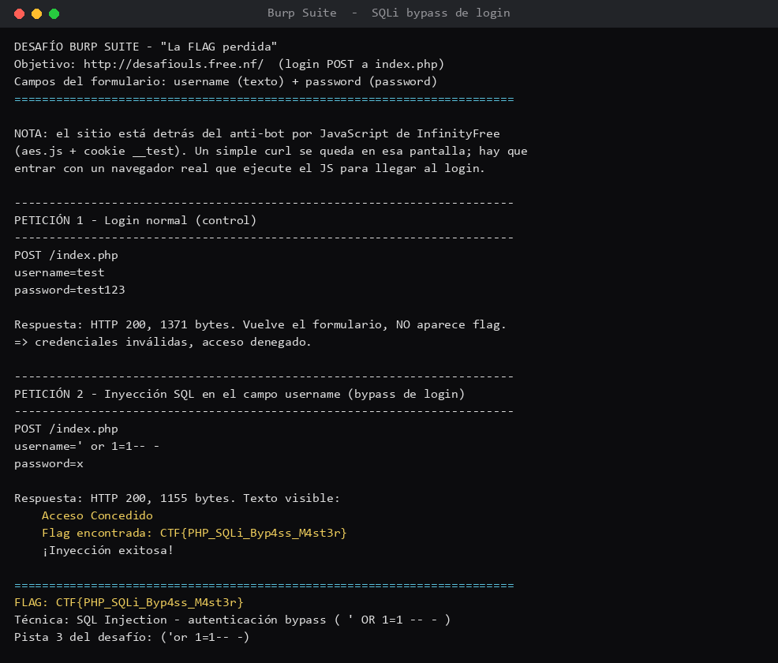

# Desafío 6 — La FLAG perdida (Burp Suite / SQL Injection)

## Qué pedía el desafío

Había un panel de administrador en `http://desafiouls.free.nf` con dos campos, usuario y
contraseña. La misión era examinar cómo funcionaba el login y ver si se podía entrar a un registro
sin estar autorizado, para recuperar una FLAG con formato `CTF{???}`. La idea es usar Burp Suite
para mirar lo que manda el formulario y después modificarlo.

## Con qué lo hice

- **Burp Suite (Proxy)**: se pone en medio entre el navegador y el sitio y te deja ver y editar lo
  que viaja. Con eso uno "pilla" el POST del login y le cambia los valores antes de que lleguen al
  servidor.
- **Inyección SQL**: el truco de meter un pedazo de consulta en un campo de texto para engañar a
  la base de datos. Acá iba en el campo usuario.

El sitio es el objetivo que el propio desafío autorizaba atacar, así que me limité a lo justo:
una entrada normal de control y una inyección, nada más.

## Lo que fui haciendo

La idea era: abrir el sitio, interceptar el POST del login con Burp, y cambiar el usuario por la
inyección. Primero probé una entrada normal, para ver cómo se comportaba el login con datos
cualquiera (esto es el "control", para comparar):

```
POST /index.php
username=test
password=test123
```

Me devolvió el mismo formulario, sin FLAG: credenciales inválidas, acceso denegado. Hasta ahí,
todo normal.

Después vino lo bueno. En vez de un usuario real, en el campo `username` metí la inyección de la
Pista 3, `' or 1=1-- -`. Eso hace que la condición del login sea siempre verdadera, así que la
base de datos "cree" que el usuario es válido aunque la contraseña sea cualquier cosa:

```
POST /index.php
username=' or 1=1-- -
password=x
```

Y ahí apareció:

```
Acceso Concedido
Flag encontrada: CTF{PHP_SQLi_Byp4ss_M4st3r}
¡Inyección exitosa!
```

## Donde me enredé

Lo que más me costó no fue la inyección, fue entrar al sitio. Está alojado en InfinityFree, que
tiene una protección anti-bots por JavaScript (una pantalla con `aes.js` y una cookie `__test`
que se pone sola). Por eso cuando intenté llegar directo con `curl` me quedaba pegado en esa
pantalla y nunca veía el login. La solución fue abrirlo con un navegador de verdad, que ejecuta
ese JavaScript, pasa la protección y recién ahí deja ver el formulario para poder hacer la prueba.
Una vez dentro, el `' or 1=1-- -` funcionó a la primera.

## Las pistas

El desafío traía pistas progresivas y usé la **Pista 3**, que era directamente la inyección
`(' or 1=1-- -)`. Las pistas 1 y 2 eran de cómo interceptar con Burp (activar el intercept después
de abrir la URL y mirar la petición en "Pretty"), que es la parte de ver el POST.

## La FLAG

`CTF{PHP_SQLi_Byp4ss_M4st3r}`

Técnica: **SQL Injection** para saltarse la autenticación (`' OR 1=1 -- -`).

## Qué saqué en limpio

Que una inyección SQL clásica es sorprendentemente simple cuando el sitio no filtra lo que uno
escribe: una comilla y un `or 1=1` bastan para romper el login. Y de paso me quedó claro por qué
siempre insisten con validar la entrada del usuario, porque todo este ataque vive de que el
servidor confía en lo que le mandan. Eso sería.


